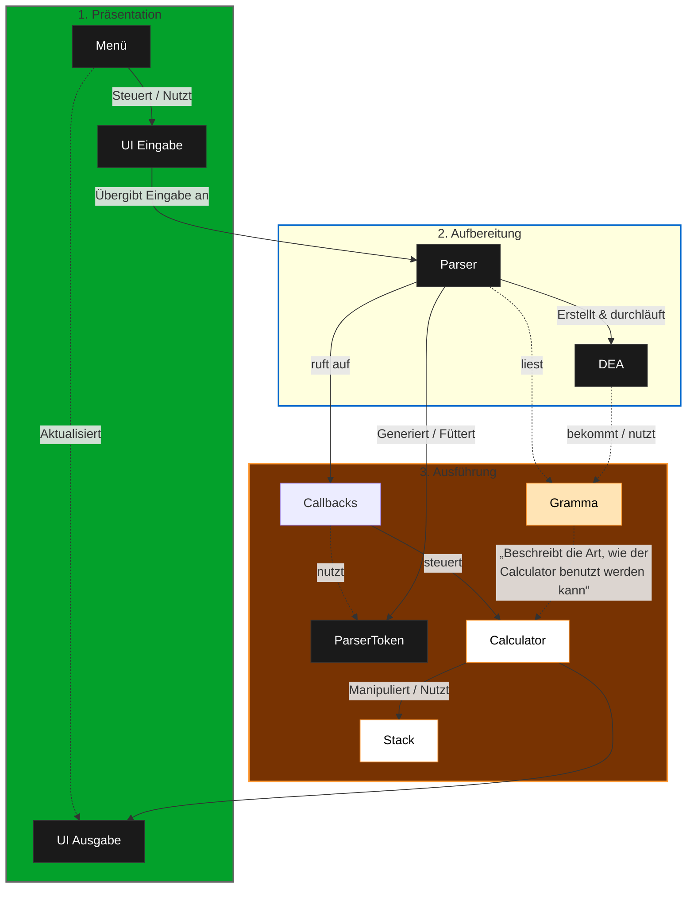
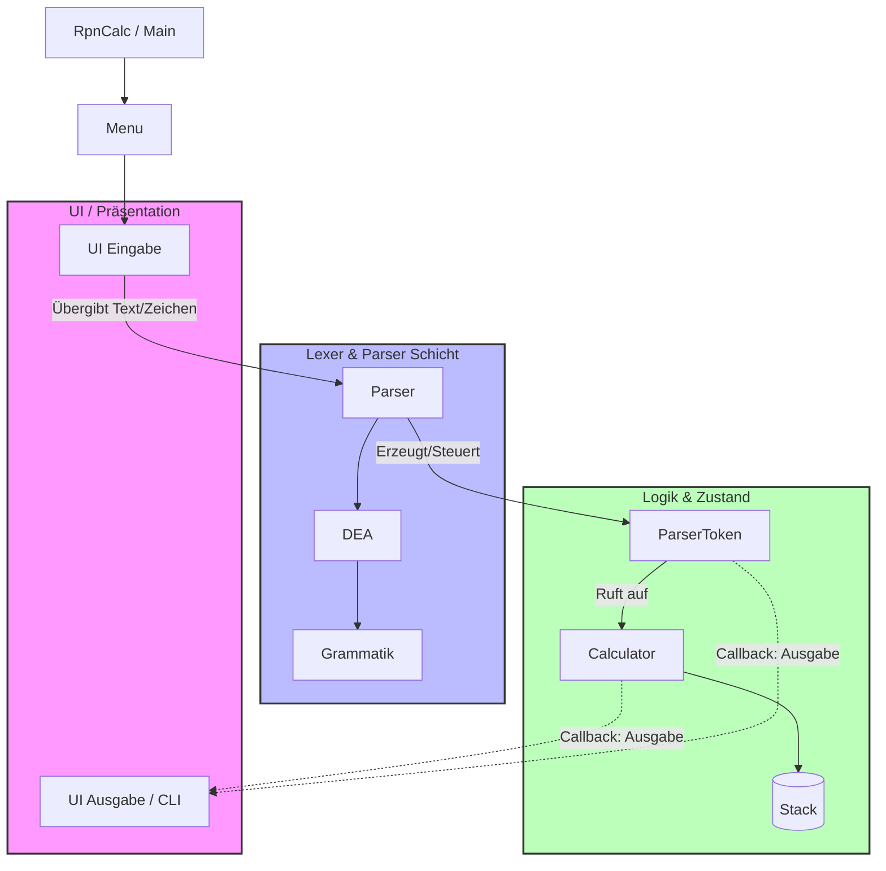

# Architektur-Dokumentation: RPN-Calculator (Compiler-Design)

Dieses Dokument beschreibt die Softwarearchitektur des **CLI RPN Calculators**. Die Anwendung nutzt ein klassisches Compiler-Frontend-Design (Grammatik, DEA, Parser), um Benutzereingaben zu validieren und in Befehle für die RPN-Engine (Calculator) zu übersetzen.

## 1. Systemübersicht & Schichtenmodell

Die Architektur ist ein Schichtenmodell. Jede Schicht hat ihre Aufgabe beim Verarbeiten der Eingabe, der Zustandstransformation oder der Ausgabe.

*   **Main & Menu:** Der Einstiegspunkt der Anwendung. Koordiniert den Start und die Menüführung.
*   **UI Layer (Eingabe / Ausgabe):** 
    *   *UI Eingabe:* Nimmt Zeichen/Zeilen vom Benutzer entgegen und schiebt sie in den Parser.
    *   *UI Ausgabe:* Empfängt Resultate oder Fehler über einen **Callback-Mechanismus**, der bis zum Calculator durchgereicht wird. (Noch nicht implementiert)
*   **Lexer- & Parser-Schicht (Grammatik, DEA, Parser):**
    *   *DEA (Deterministischer Endlicher Automat):* Konsumiert Zeichen und wandelt sie anhand der Grammatik in Token/Kommandos um.
    *   *Parser:* Holt Kommandos vom DEA und steuert die Evaluierung.
*   **Execution Layer (ParserToken, Calculator):**
    *   *Grammatik:* Hält die Symbol- und Übergangstabellen für den Calculator.
    *   *ParserToken:* Repräsentiert die semantische Aktion (z.B. Puffer füllen, Zahl erzeugen, Calculator triggern).
    *   *Calculator & Stack:* Verwaltet den LIFO-Speicher (Stack) und führt die eigentlichen mathematischen Operationen aus. (noch nicht implementiert)

---
## 2. Komponenten- und Schichten / Säulen-Diagramm

Das folgende Diagramm zeigt die Klassenstruktur und wie die Abhängigkeiten verlaufen.

---

## 2. Komponenten- und Schichten-Diagramm

Das folgende Diagramm zeigt deine exakte Klassenstruktur und wie die Abhängigkeiten verlaufen.

---

## 3. Sequenzdiagramm: Von der Eingabe zur Berechnung

Dieses Diagramm zeigt den genauen Ablauf, wenn die UI-Eingabe eine Zeichenkette verarbeitet (z.B. eine Zahl oder einen Operator). Es verdeutlicht auch, wie der DEA Kommandos generiert und wie die Ausgabe per Callback zurückfließt.

---

## 4. Detaillierte Funktionsweise der Kernkomponenten

### 1. Grammatik & DEA
Die **Grammatik** definiert das Alphabet und die gültigen Zustandsübergänge (Zustandsmatrix). Der **DEA** liest den Eingabestrom Zeichen für Zeichen aus der **UI Eingabe**. Bei jedem gültigen Zustandsübergang emittiert der DEA ein Kommando an den **Parser**.

### 2. Parser & ParserToken
Der **Parser** agiert als Steuereinheit. Er wartet auf die Kommandos des DEA. Sobald ein valides Kommando erkannt wird, instanziiert oder füttert er das **ParserToken**. 
Das **ParserToken** besitzt die Logik für die Akkumulation von Daten (z. B. einen String-Buffer für mehrstellige Zahlen wie `123`) und weiß, wann es die Geschäftslogik des **Calculators** aufrufen muss.

### 3. Calculator & Stack
Der **Calculator** kapselt den eigentlichen RPN-Speicher (**Stack**). Er führt die Pop- und Push-Operationen aus. Er bleibt vollständig entkoppelt von der UI, indem er Berechnungsresultate oder Fehler (z.B. *Division durch Null* oder *Zu wenige Operanden*) über einen Funktionszeiger / ein Interface (**Callback**) direkt an die **UI Ausgabe** meldet.
