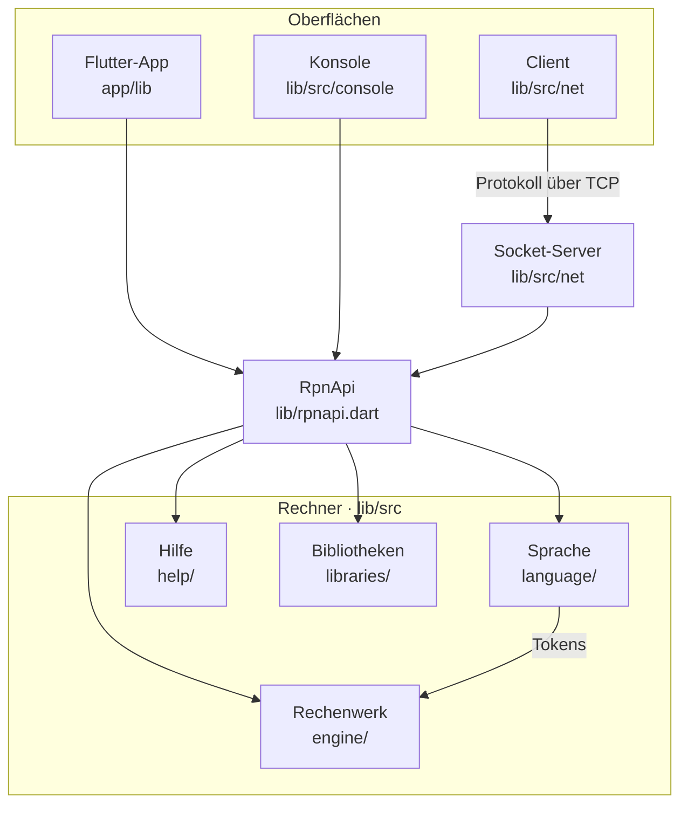

# Architektur

Wie der RPN-Rechner aufgebaut ist: welche Teile es gibt, wer wen benutzen darf und wo spätere Erweiterungen
andocken. Die Sprache beschreibt [reference.md](reference.md), die Schnittstelle des Rechners [api.md](api.md),
die Oberfläche der App [app.md](app.md).

> **Stand:** Zielbild aus RG-1 (2026-11-07), umgesetzt (2026-11-07). Abschnitt 8 zeigt die Schritte.

## 1. Überblick

Ein Rechner, drei Oberflächen. Alle Oberflächen sprechen mit dem Rechner nur über `RpnApi`: Zeichen hinein,
`Zustand` heraus.



Der Rechner ist reines Dart ohne Flutter und ohne `dart:io`. Deshalb läuft er überall: in der Konsole, auf
dem Handy und im Browser.

## 2. Der Rechner

### 2.1 Von der Taste zum Ergebnis

1. `RpnApi.taste(zeichen)` gibt weiter an den **Interpreter** (`engine/interpreter.dart`). Er führt die
   aktuelle Zeile und ihren ersten Fehler und gibt jedes Zeichen an den **Parser**.
2. Der Parser schickt es durch den **DEA**. Die Übergangstabelle kommt aus der **Grammatik** (`grammar.dart`,
   EBNF in reference.md Anhang A). Jeder Übergang liefert ein Kommando, z.B. „Zeichen anhängen“ oder „Token
   fertig“.
3. Der **TokenBuilder** (`RpnToken`) sammelt die Zeichen zu einem Token: Zahl, Name, Operator, Code-Block …
4. Ist ein Token fertig, ruft der Parser den Callback auf, den der **Calculator** für diese Token-Art
   angemeldet hat (`onNummer`, `onFunktion`, …).
5. Der Calculator führt das Token in einem festen Ablauf aus: Enter-Logik, Argumente übernehmen, Aktion
   ausführen, Ergebnis oder Fehler. Bricht ein Token mit einem Fehler ab, bleibt alles wie vorher.
6. `api/state.dart` baut daraus den **Zustand**: Stack, Variablen, Tags, eigene Funktionen, Fehler, offenes
   Token. `RpnApi` selbst steuert nichts, jede Methode gibt nur weiter.

Eigene Funktionen führt der Calculator rekursiv über denselben Parser aus (`codeAusfuehren`).

### 2.2 Bausteine

| Ordner | Inhalt |
|---|---|
| `lib/rpnapi.dart` | die Tür: `RpnApi` gibt nur weiter; exportiert `Zustand`, `StackZeile`, `Speicher`, `Fehler` und was Oberflächen sonst brauchen |
| `lib/src/api/` | hinter der Tür: der Zustand als Daten mit JSON (`state.dart`), die Bibliotheken eines Rechners (`libraries.dart`), das Nachschlagen der Hilfe (`help_lookup.dart`) und die eingebaute Hilfe (`builtin_help.dart`, `Hilfetexte`: lädt `library/system/hilfe.de.rpnlib`) |
| `lib/src/language/` | Grammatik, DEA, Parser, RpnToken: aus Zeichen werden Tokens |
| `lib/src/engine/` | Interpreter (Zeile, Fehler, Löschen, Skripte); Calculator als Koordinator; Kern (Stack, Operanden, Fehler) und die Mixins Speicher, Funktionen, Operatoren, Stack-Befehle; Enter-Logik; Sitzung als Skript (`session.dart`) |
| `lib/src/help/` | Hilfe-Modell (`Hilfe`, `Verwendung`, `Argument`) |
| `lib/src/libraries/` | die mitgelieferten Bibliotheken und Systemdateien als erzeugte Konstanten (`libraries.g.dart` aus `library/*.rpnlib` und `library/system/*.rpnlib`) |
| `lib/src/format.dart` | das Excel-Format der Zwischenablage, gemeinsam für App und Konsole; `rpnapi.dart` exportiert es zusammen mit `zahl` und `positionsName` aus `helper.dart` |

Neue Funktionen trägt man in die Tabelle des passenden Mixins ein. Neue Hilfetexte stehen in
`library/system/hilfe.de.rpnlib`.

## 3. Konsole und Netz

| Ordner | Inhalt |
|---|---|
| `lib/console.dart` | Tür für `bin/rpncalc.dart` und `bin/client.dart` |
| `lib/src/console/` | zeilen- und zeichenweise Eingabe (`ui`, `screen`), Darstellung (`display`, Klasse `Darstellung`), Menü, Konsolenhilfe, Zwischenablage, Terminal-Einstellungen |
| `lib/src/selftest/` | Testfälle für DEA, Parser und Rechner, startbar aus dem Menü und mit `dart test` |
| `lib/net.dart` | Tür für `bin/server.dart`, `bin/client.dart` und den Server-Start aus dem Menü |
| `lib/src/net/` | Protokoll (JSON-Nachrichten), Server, `EntfernterRechner` |

Die Konsole kennt den Rechner über die Schnittstelle `Rechner` (`taste`, `zeilenende`, `loeschen`, `zustand`,
`hilfe`). `LokalerRechner` ruft `RpnApi` direkt auf, `EntfernterRechner` schickt dieselben Aufrufe an den Server.

## 4. Die App

### 4.1 Aufbau

```
app/lib/
  main.dart          Start, Zoom, Seitenaufbau, Tasten der PC-Tastatur
  colors.dart        Farben und Schriften (Rollen statt Farbwerte)
  keys.dart          die Tasten und ihre Belegung (Taste, Aktion)
  help_texts.dart    Hilfe und Tooltips der App zusammensetzen (AppHilfe)
  help_texts_de.dart alle deutschen Texte dazu; eine weitere Sprache bekommt eine Datei daneben
  tooltip.dart       Tooltips und wann sie ruhen (TippSperre)
  model/             der Zustand der App, ohne Widgets
  display/           die Anzeige: Seiten, Statuszeile, Hilfeschirm, Kontextmenü
  keypad/            das Tastenfeld: Tasten, Cursorkreuz, Zeichnungen
```

Die Widgets lesen das Modell und rufen seine Methoden auf. Sie rechnen nicht selbst und sprechen nicht mit
`RpnApi`, außer um Hilfetexte nachzuschlagen.

### 4.2 Das Modell

`RechnerModell` (ein `ChangeNotifier`) ist die einzige Klasse, die die Widgets kennen. Damit die Datei
überschaubar bleibt, ist es nach Aufgaben geteilt, wie der Calculator: `ModellKern` hält den gemeinsamen Zustand
und schreibt in den Rechner, je ein Mixin `on ModellKern` in einer eigenen `part`-Datei übernimmt eine Aufgabe.
Was ein Teil von einem anderen braucht, deklariert der Kern abstrakt („Was die Teile voneinander brauchen“); so
stehen die Abhängigkeiten zwischen den Teilen an einer Stelle.

| Datei | Aufgabe |
|---|---|
| `model.dart` | `RechnerModell`, `ModellKern`: `RpnApi`, `Zustand`, Umschaltungen, Bereich, Verlauf, Schreiben in den Rechner, Zeilenumbruch |
| `input.dart` | Tastendruck und Präfixe (Shift, ~, \|, ', Alpha) |
| `assignment.dart` | Belegung der Funktionstasten (Seiten, Domänen, Variablen, eigene Funktionen, Mausrad) und Beschriftung der Tasten |
| `help_mode.dart` | Hilfe-Modus: Seitenfolge, Verweise, Lese-Modus |
| `clipboard.dart` | Kopieren, Einfügen, `\c` `\s` `\v` |
| `viewport.dart` | Ausschnitte der Anzeige: Versatz im Stack und Verlauf, waagrechtes Schieben, Pfeile |
| `keyboard.dart` | Zeichen der PC-Tastatur auf Tasten abbilden, Leuchten der Tasten |
| `modes.dart` | die Bedienmodi Rechnen und Hilfe (4.3) |

### 4.3 Bedienmodi

Rechnen und Hilfe sind **Bedienmodi** (`modes.dart`): je ein Objekt mit `druecke`, `tippeZeichen`,
`zeilenende`, `pfeil`, `tab`, `esc`, `hilfe` (F1) und einer eigenen `beschriftung` für einzelne Tasten. Das
Modell gibt jede Bedienung an den aktiven Modus (`modus`) weiter, statt an jeder Stelle `hilfeModus` abzufragen;
`hilfeModus` heißt nur noch „der Modus Hilfe ist aktiv“ und dient der Anzeige. Rechnen gibt an Eingabe, Tastatur
und Ausschnitt weiter (`_druckeRechnen` …), Hilfe enthält selbst, was Tasten und Pfeile dort bewirken; den
Zustand der Hilfe (Seiten, Verweise) führt `help_mode.dart`. Wischen und Mausrad über den Funktionstasten fragen
`hilfeModus` noch selbst ab. Das Menü (FA-6) wird ein weiterer Modus.

### 4.4 Anzeige und Tastenfeld

- `display/`: `display.dart` (Rahmen mit den Seiten zum Wischen), `status_line.dart`, `calc_page.dart`
  (Rechnen), `list_page.dart` (Variablen und Tags, Funktionen), `help_screen.dart`, `context_menu.dart`.
- `keypad/`: `keypad.dart` (das Tastenfeld aus den Blöcken R1, R2–R5 und R6–R9, Rahmen um die
  Funktionstasten, Maximieren-Ecke), `function_block.dart` (die zehn Funktionstasten, verschiebbar mit Wischen und
  Mausrad), `key_widget.dart` (eine Taste), `cursor_cross.dart`. Jede Zeichnung
  (CustomPainter) steht bei dem Widget, das sie benutzt. Für das Querformat (FA-5) werden die Blöcke nur anders
  angeordnet.

## 5. Wer darf wen benutzen

| Teil | darf benutzen |
|---|---|
| `lib/src/language` | nichts aus dem Projekt außer `helper` |
| `lib/src/engine` | `language`, `helper`, `version` |
| `lib/src/libraries` | nichts (nur erzeugte Konstanten) |
| `lib/src/help` | nichts: nur die Klassen der Hilfe |
| `lib/src/api` | `engine`, `help`, `libraries`, `helper`, `version` |
| `lib/rpnapi.dart` | `api`, dazu die Typen, die es exportiert (`engine`, `help`, `format`, `helper`); gerechnet und gesteuert wird nur dahinter |
| `lib/src/console` | nur `rpnapi.dart` |
| `lib/src/net` | `rpnapi.dart`; der Client dazu die Schnittstelle `Rechner` der Konsole (`console/screen.dart`) |
| `lib/src/selftest` | `rpnapi.dart` und `language` (Tests von DEA und Parser) |
| `bin/` | nur die Türen `rpnapi.dart`, `console.dart`, `net.dart` |
| `app/lib` | nur `package:rpncalc/rpnapi.dart` (geprüft in `test/architecture_test.dart`) |
| `test/`, `app/tool` | auch `lib/src` (im eigenen Paket erlaubt); Tests kommen über `test/internals.dart` an den Interpreter einer `RpnApi` |

Nichts im Rechner kennt eine Oberfläche. Meldungen gehen nicht über Callbacks nach außen, sondern stehen im
`Zustand`.

## 6. Nähte für später

| Vorhaben | wo es andockt |
|---|---|
| Sitzungen, Speichern (FA-8, RG-2) | Platz frei: der Rechner liefert seinen Stand als Skript (`Export`) und lädt ihn als Eingabe. Wo und wie gespeichert wird, entscheidet jede Umgebung selbst. Die App bekommt dafür später eine eigene Schicht unter `model/` |
| Undo (FR-4) | nur im Rechenwerk: ein Protokoll der Änderungen im Kern. Die App ändert alles über `RpnApi`, braucht also nur eine Taste |
| Menü (FA-6) | ein weiterer Bedienmodus |
| Fachbereiche (FA-7) | `assignment.dart` im Modell, Bibliotheken über `RpnApi` |
| Querformat (FA-5) | Blöcke des Tastenfelds anders anordnen, Zoom nach der Höhe in `main.dart` |
| Wischen mit Nachlauf (FA-24) | `viewport.dart` |
| Lua (FS-6) | ein eigenes Modul neben dem Rechenwerk, nicht darin: FFI gibt es im Browser nicht, der Kern bleibt reines Dart |
| Sondertasten der API (RR-3) | entschieden: eigene Methoden (`zeilenende`, `loeschen`), keine Steuerzeichen in `taste()` |

## 7. Regeln für Dateien

- Verzeichnis- und Dateinamen englisch (auch die Tests), Bezeichner und Kommentare deutsch.
- Eine Datei hat höchstens etwa 400 Zeilen. Wird sie größer, wird sie nach Aufgaben geteilt.
- Jede Datei beginnt mit einem Kopfkommentar vor `library;` (bei `part`-Dateien vor `part of`):

```dart
/// Aufgabe: was die Datei tut, für wen, mit den wichtigsten Klassen (bis zu 10 Zeilen).
///
/// Abgrenzung: was bewusst woanders liegt, und wo (2–5 Zeilen).
///
/// Siehe auch: Dateien und Kapitel der Spezifikation, die man zum Verständnis braucht (2–5).
library;
```

- Werkzeuge unter `tool/` behalten ihre Namen, weil Abläufe in process/workflow.md auf sie verweisen.

## 8. Umbau

Jeder Schritt ist ein eigener Eintrag im Backlog und ein eigener Commit. Er ändert kein Verhalten, die Tests
bleiben grün. Neue Dateien bekommen ihren Kopfkommentar gleich im Schritt, der sie anlegt. Im CHANGELOG stehen
alle Schritte zusammen als eine Zeile („Internal restructuring, no visible change“).

| Schritt | Eintrag |
|---|---|
| 1. Excel-Format aus der Konsole lösen, die App importiert nur noch `rpnapi.dart` | VR-4 erledigt |
| 2. Rechner nach `lib/src`, englische Dateinamen, Türen `console.dart` und `net.dart` | VR-5 erledigt |
| 3. App: englische Dateinamen, Ordner, `anzeige.dart` teilen | VA-6 erledigt |
| 4. `tastenfeld.dart` (heute `keypad/`) teilen | VA-7 erledigt |
| 5. `modell.dart` (heute `model/`) über `part`-Dateien teilen | VA-8 erledigt |
| 6. Kopfkommentare in den übrigen Dateien, Testdateien englisch, dieses Dokument auf den erreichten Stand | DG-6 erledigt |
| 7. Bedienmodi | VA-9 erledigt |
| 8. `RpnApi` als reine Tür: Interpreter, `lib/src/api/` | VR-6 erledigt |
