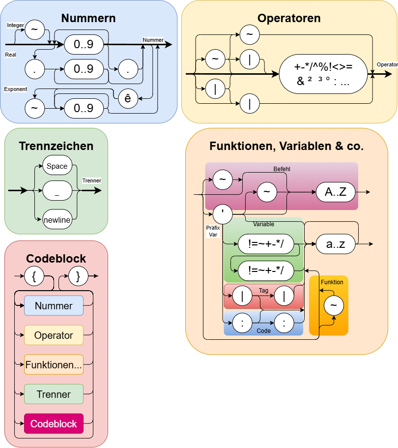

# RPN-Rechner: Sprachreferenz

Stand: 27.10.2026 · Entwurf

Diese Referenz beschreibt, was der Rechner mit einer Eingabe tut. Wie er intern aufgebaut ist (DEA, Parser,
Bausteine), steht in [architecture.md](architecture.md), die Schnittstelle für Oberflächen in [api.md](api.md).
Kurze Abschnitte „Warum so?“ halten fest, weshalb eine Regel so gewählt wurde.

---

## 1. Einleitung

Der Rechner arbeitet mit umgekehrter polnischer Notation (RPN): Erst kommen die Werte, dann die Operation.
`3 4+` legt 3 und 4 auf den Stack und addiert sie. Die Sprache ist für eine PC-Tastatur ausgelegt und kommt
ohne Klammern für Ausdrücke aus.

### Begriffe

| Begriff     | Bedeutung |
|-------------|-----------|
| Stack       | Der Werte-Stack, auf dem gerechnet wird |
| Tos         | Top of Stack, das oberste Element (Position 0) |
| Position    | Abstand zum Tos: 0 ist der Tos, 1 das Element darunter usw. |
| x, y, z, t  | Namen der Positionen 0 bis 3; x ist der Tos (wie bei HP, aber klein, weil X und Y Befehle sind) |
| ≡₄, ≡₅ …    | Positionen ab 4; allgemein ≡ₙ für die Position n, z.B. aus einem Argument |
| Feld        | Variable oder Konstante mit mehreren Elementen; Element 0 ist der Wert, der beim Anlegen in x lag |
| name        | Platzhalter für den Namen einer Variablen, Konstante, eines Tags oder einer Funktion: `'!name`, `':name` |
| Füllstand   | Anzahl der belegten Zellen des Stacks (in der API: `tiefe`) |
| Token       | Ein Baustein der Eingabe: Zahl, Operator, Befehl, Funktion, Variable, Tag oder Code-Block |
| Identifier  | Funktionen, Befehle, Variablen und Tags; sie verbrauchen Argumente |
| Code-Stack  | Ein zweiter Stack, getrennt vom Werte-Stack, für Code-Blöcke |

### Schreibweise der Beispiele

Eingaben stehen in `"…"`, der Stack danach in `[…]` mit dem Tos rechts: `"1 2+"` ergibt `[3]`.
Ein sichtbares Leerzeichen wird als `␣` geschrieben, wo es darauf ankommt.

**Zeichensatz:** Code und Skripte sind UTF-8. Zeichen wie `ê ² ³ °` gibt es auch in der alten Windows-Codepage,
`≤ ≥ ≠` nicht: Wer eine Datei ausdrücklich als „ANSI“ speichert, verliert sie. Alle üblichen Schriften
(Consolas, Lucida Console, Courier, Cascadia, Segoe UI, Arial) enthalten sie, Notepad speichert seit Windows 10
als UTF-8.

**Wirkung auf den Stack:** `y x → y+x` heißt: y und x werden verbraucht, y+x liegt danach in x. Links steht,
was die Operation nimmt, rechts, was sie zurücklegt, jeweils der Tos rechts. `x → –` heißt: x wird verbraucht,
nichts kommt zurück. Diese Schreibweise gilt für alle Texte: Referenz, Hilfe, Tooltips.

---

## 2. Grundmodell

### 2.1 Stack

- Der Stack ist ein Ringpuffer mit 1000 Zellen, wie bei den HP-Taschenrechnern.
- **Namen der Positionen:** x (Tos), y, z, t für die Positionen 0 bis 3, darunter ≡₄, ≡₅ usw. In Texten
  heißt es also „tauscht x und y“ oder „kopiert ≡₅ nach x“; ≡ₙ steht für eine Position, die ein Argument
  angibt. ≡₀ bis ≡₃ wären gültig, man schreibt aber die Buchstaben.
- Läuft er über, wird das älteste Element überschrieben. Der Füllstand bleibt dann bei 1000.
- Wird von einem leeren Stack etwas genommen, liefert er 0 (wie beim HP). Der Füllstand bleibt bei 0.
- Getaggte Zellen werden nie überschrieben oder verbraucht (siehe [Kapitel 9](#9-tags)).

### 2.2 Werte

Alle Werte sind Zahlen (Gleitkomma). Einige Operationen liefern ganze Zahlen, z.B. `|/` oder `n:rnd`.
Ungültige Rechnungen wie `1 0/` oder `~2 0.5^` liefern unendlich bzw. NaN; nur wo ein Gate eingebaut ist
(z.B. `|/`), gibt es stattdessen einen Fehler.

**Anzeige:** Gerechnet wird mit voller Genauigkeit. Angezeigt (und kopiert) wird auf 12 Nachkommastellen
gerundet, damit Reste der Gleitkommarechnung verschwinden: `0.1 0.2+` zeigt 0,3, `200 15%` zeigt 30.
Würde eine Zahl ≠ 0 dabei zu 0, wird sie mit 12 gültigen Stellen und Exponent gezeigt, z.B. `4.11032e-19`.
Soll ein Ergebnis selbst 0 sein, kann deshalb ein Rest sichtbar werden: `0.1 0.2+0.3-` zeigt `5.55111512313e-17`.

### 2.3 Verarbeitung

Die Eingabe wird Zeile für Zeile verarbeitet, jedes Token sofort ausgeführt. Ein Code-Block darf sich über
mehrere Zeilen erstrecken (siehe [Kapitel 10](#10-code)).

### 2.4 Fehlerverhalten

- Ein Fehler beendet die Verarbeitung der Zeile. Der Rest der Zeile wird nicht ausgeführt.
- Was vor dem Fehler ausgeführt wurde, bleibt bestehen: `"1 2+ 'q 4 5"` ergibt `[3]` und den Fehler
  „Variable ist nicht definiert: q“.
- Das fehlerhafte Token selbst hinterlässt keine Spuren, alles bleibt so wie vor dem Token:
  - Werte, die es schon geholt hatte, werden zurückgelegt (`"5 0|/"` lässt `[5 0]` stehen).
  - Ein dup durch das Leerzeichen davor wird zurückgenommen, das Enter ist wieder vorgemerkt. Im Beispiel
    oben wäre sonst `[3 3]` stehen geblieben.
  - Mit `:` übergebene Argumente liegen wieder bereit.
  - Ausnahme: Was der Code einer eigenen Funktion vor einem Fehler darin verändert hat, bleibt.
- Gemeldet wird der erste Fehler mit dem fehlerhaften Token und seiner Position in der Zeile.

Alle Fehler sind in [Kapitel 12](#12-fehler) aufgelistet.

---

## 3. Eingabe

### 3.1 Zahlen

| Form           | Beispiel   | Wert   |
|----------------|------------|--------|
| ganze Zahl     | `42`       | 42     |
| Dezimalzahl    | `3.14`, `.5`, `5.` | 3,14 · 0,5 · 5 |
| negativ        | `~7`       | −7     |
| Exponent       | `1.5ê3`    | 1500   |
| neg. Exponent  | `1ê~2`     | 0,01   |

- `~` vor einer Zahl macht sie negativ, `~` nach `ê` macht den Exponenten negativ.
- Zwischen Zahl und `ê` darf kein Leerzeichen stehen (`"1 ê2"` ist ein Fehler).
- Ein zweiter Punkt beginnt eine neue Zahl: `"1.2.3"` ergibt `[1.2 0.3]`.

> **Warum so?** `-` ist die Subtraktion, deshalb steht `~` für das Vorzeichen. `e` ist die Eulersche Zahl,
> deshalb leitet `ê` den Exponenten ein.

### 3.2 Namen

- Funktionen, Variablen und Tags haben Namen aus Kleinbuchstaben `a`–`z`, beliebig lang.
- Befehle bestehen aus genau einem Großbuchstaben (`D`, `S`, `R` …). Sie brauchen kein trennendes Zeichen:
  `"2 3S"`.
- Ein Name endet am ersten Zeichen, das kein Kleinbuchstabe ist: `"deg50"` ist `deg` und `50`.

> **Warum so?** Großbuchstaben sind kurze, häufige Befehle. Kleinbuchstaben bleiben für Funktionen und eigene Namen frei.

### 3.3 Trenner

#### Wozu Trenner?

Die Eingabe ist eine fortlaufende Zeichenkette. Der Rechner muss entscheiden, wo ein Token endet und das
nächste beginnt. Meist ergibt sich das von selbst, weil das nächste Zeichen nicht mehr zum Token passen kann:

| Eingabe   | Zerlegung | Warum kein Trenner nötig ist |
|-----------|-----------|------------------------------|
| `"3 4+5"` | `3` `4` `+` `5` | `+` kann nicht zu einer Zahl gehören, `5` nicht zum Operator |
| `"2pi"`   | `2` `pi` | ein Buchstabe beendet die Zahl |
| `"deg50"` | `deg` `50` | eine Ziffer beendet den Namen |
| `"4²²"`   | `4` `²` `²` | Operatoren aus einem Symbol enden sofort |
| `"5'!a"`  | `5` `'!a` | `'` beginnt immer ein neues Token |
| `"2 3S"`  | `2` `3` `S` | Befehle bestehen aus einem Zeichen |

Nötig ist ein Trenner nur, wenn zwei Token gleicher Art aufeinander folgen und sonst zu einem verschmelzen würden:

| ohne Trenner | wird gelesen als | mit Trenner |
|--------------|------------------|-------------|
| `"12"`       | die Zahl 12      | `"1 2"` oder `"1_2"`: 1 und 2 |
| `"pisin"`    | die Funktion `pisin` (Fehler) | `"pi sin"` oder `"pi_sin"` |

#### Die drei Trenner

| Zeichen     | Wirkung |
|-------------|---------|
| Leerzeichen | trennt **und** wirkt als Enter (dup des Tos), außer in zwei Fällen, siehe 3.4 |
| `_`         | trennt nur, sonst keine Wirkung |
| Zeilenende  | wie `_` |

Dass das Leerzeichen mehr tut als zu trennen, ist der wichtigste Unterschied zu anderen Sprachen. Dort darf
man Leerzeichen beliebig zur Gliederung einsetzen, hier verändern sie das Ergebnis.

### 3.4 Leerzeichen als Enter

#### Vorbild: die Enter-Taste der HP-Rechner

Bei einem RPN-Taschenrechner von HP gibt es keine Taste zum Trennen. Die Enter-Taste übernimmt diese Aufgabe:

- **Kopie anlegen:** Enter schließt die Eingabe ab und legt eine Kopie davon auf den Stack.
- **Neue Zahl ersetzt die Kopie:** Tippt man danach eine Zahl, ersetzt sie diese Kopie. So wird `3 ENTER 4 +` zu 7, und es bleibt keine überzählige 3 liegen.
- **Operation nutzt die Kopie:** Folgt auf Enter keine Zahl, sondern eine Operation, arbeitet sie mit der Kopie. `5 ENTER ×` ergibt 25.

Enter ist beim HP also beides, Trenner und dup, je nachdem, was danach kommt. Genau so verhält sich hier das
Leerzeichen:

| HP-Rechner              | hier          | Ergebnis      |
|-------------------------|---------------|---------------|
| `3 ENTER 4 +`           | `"3 4+"`      | `[7]`         |
| `5 ENTER ×`             | `"5 *"`       | `[25]`        |
| `1 ENTER eˣ`            | `"1 exp"`     | `[1 2.718…]`  |
| `1 ENTER ENTER 2`       | `"1  2"`      | `[1 1 2]`     |
| `3 ENTER 4 + 5`         | `"3 4+5"`     | `[7 5]`, nach einer Operation braucht die nächste Zahl keinen Trenner |

#### Die Regel

Das Leerzeichen verdoppelt den Tos, außer in zwei Fällen, in denen es nur trennt:

- **Zahl ␣ Zahl:** `"1 2"` ergibt `[1 2]`. Das entspricht dem HP, bei dem die neue Zahl die Kopie ersetzt.
- **Identifier ␣ Identifier:** `"pi sin"` oder `"'a 'b"`. Gemeint sind Funktionen, Variablen und Tags; Befehle und
  Code-Blöcke zählen hier nicht dazu. Diese Ausnahme gibt es beim HP nicht, weil dort jede Funktion eine eigene
  Taste hat. Hier sind Funktionen Namen, die man trennen können muss.

In allen anderen Fällen wirkt es als Enter, z.B. zwischen Zahl und Operator, Zahl und Funktion, zwischen zwei
Operatoren oder vor einem Befehl.

**Ablauf im Einzelnen**

- Das Leerzeichen wird erst ausgeführt, wenn das nächste Token kommt, denn erst dann steht fest, ob es nur trennt.
- Mehrere Leerzeichen wirken mehrfach.
- `_` ist für diese Regel unsichtbar.
- Enter auf dem leeren Stack legt eine 0 ab: `"␣5"` ergibt `[0 5]`.
- Ein Leerzeichen am Zeilenende bleibt vorgemerkt, das erste Token der nächsten Zeile entscheidet:
  `"5␣"` und danach `"+"` ergibt `[10]`, `"5␣"` und danach `"3"` ergibt `[5 3]`.

### 3.5 Vor- und Nachteile

**Vorteile**

- **Vertraut:** Wer einen HP-Rechner kennt, tippt wie gewohnt. `"5 *"` quadriert wie `5 ENTER ×`.
- **Kurz:** Häufige Muster brauchen keinen eigenen Befehl für dup: `"3 4° ~°"` verdoppelt φ vor `~°`.
- **Eine Taste:** Auf der geplanten Bildschirmtastatur liegt Enter auf der Leertaste. Damit gibt es nur eine
  Taste zum Trennen und Verdoppeln, wie beim HP.

**Nachteile**

- **Leerzeichen sind nicht neutral.** Wer aus anderen Sprachen gewohnt ist, Ausdrücke mit Leerzeichen zu gliedern,
  bekommt andere Ergebnisse:

  | Eingabe         | Ergebnis      | Erwartet wohl |
  |-----------------|---------------|---------------|
  | `"1 2 3 + +"`   | `[1 2 12]`    | `[6]`, richtig wäre `"1 2 3++"` |
  | `"1 exp"`       | `[1 2.718…]`  | `[2.718…]`, richtig wäre `"1_exp"` oder `"1exp"` |
  | `"1  2"`        | `[1 1 2]`     | `[1 2]` |

- **Unsichtbare Fehler:** Ein doppeltes Leerzeichen oder ein Leerzeichen am Zeilenanfang oder -ende sieht man kaum,
  es verändert aber den Stack.
- **Kontext nötig:** Ob ein Leerzeichen verdoppelt, erkennt man erst am nächsten Token. Beim Lesen von Code muss man
  beide Seiten ansehen.

**Empfehlungen**

- Zum reinen Trennen `_` verwenden, besonders in Code-Blöcken und gespeicherten Skripten (der Export macht das so).
- Das Leerzeichen bewusst als Enter einsetzen, nicht zur Gliederung.
- Längere Rechnungen auf mehrere Zeilen verteilen statt mit Leerzeichen zu gliedern: Das Zeilenende wirkt wie `_`.

> **Warum so?** Das Verhalten folgt den HP-Rechnern, deren Bedienung sich über Jahrzehnte bewährt hat, und
> passt zur geplanten Bildschirmtastatur. Die Ausnahme für Identifier erlaubt Funktionsketten wie `"pi sin"`.
> Als Ausweg für reines Trennen gibt es `_`.

---

## 4. Operatoren

- Operatoren bestehen aus einem Symbol `+ - * / ^ % ! < > = & ² ³ ° :`.
- Davor kann `~` (Umkehrung) oder `|` (Split) stehen. Sie können auch nur aus dem Präfix bestehen.
- Operatoren verbrauchen keine Argumente (siehe [Kapitel 5](#5-argumente)).

In der Tabelle ist y der Wert unter dem Tos und x der Tos. Die Ergebnisse sind mit dem Tos rechts angegeben.

| Operator | Stack vorher → nachher | Bedeutung |
|----------|------------------------|-----------|
| `+ - * /` | y x → y∘x | Grundrechenarten |
| `^`      | y x → yˣ | Potenz |
| `~^`     | y x → ˣ√y | allgemeine Wurzel |
| `²` `³`  | x → x², x³ | Quadrat, Kubik |
| `~²` `~³`| x → √x, ∛x | Quadrat- und Kubikwurzel |
| `~/`     | x → 1/x | Kehrwert |
| `!`      | x → x! | Fakultät |
| `~`      | x → −x | Vorzeichenwechsel des Tos |
| `\|\|`   | x → \|x\| | Betrag |
| `\|`     | x → Ganzzahlteil, Nachkommateil | `"3.7\|"` ergibt `[3 0.7]` |
| `\|/`    | y x → Quotient, Rest | Ganzzahldivision, `"7 2\|/"` ergibt `[3 1]`; Fehler bei x = 0 |
| `%`      | y x → y, y·x/100 | Prozentwert, `"200 15%"` ergibt `[200 30]` |
| `~%`     | y x → y, y·100/x | Grundwert: y sind x %, was sind 100 % |
| `\|%`    | y x → y·(1−x/100), y·x/100 | Vorwärts-Split, `"100 20\|%"` ergibt `[80 20]` |
| `~\|%`   | y x → y/(1+x/100), Rest | Rückwärts-Split, `"120 20~\|%"` ergibt `[100 20]` |
| `°`      | x y → r φ | kartesisch nach polar, φ im Winkelmodus; `"3 4°"` ergibt `[5 53.13]` |
| `~°`     | r φ → x y | polar nach kartesisch |
| `< > =`  | y x → 1 oder 0 | Vergleiche |
| `~< ~> ~=` | y x → 1 oder 0 | ≥, ≤, ≠ |
| `≥ ≤ ≠`   | y x → 1 oder 0 | dasselbe als Zeichen, besser lesbar; die App schreibt diese Zeichen |
| `&`      | y x → 1 oder 0 | logisches Und (0 ist falsch, alles andere wahr) |
| `~&`     | y x → 1 oder 0 | logisches Oder |
| `:`      | x → – | übergibt den Tos als Argument (Kapitel 5) |
| `~:` `~\|:` `\|:` | | lesen Argumente im Code einer eigenen Funktion (Kapitel 10) |

Nicht belegte Kombinationen (z.B. `~~`) melden „Unbekannter Operator“.

> **Warum so?** Vergleiche liefern 1 und 0, damit man mit ihnen weiterrechnen kann. `&` und `~&` sind logisch,
> nicht bitweise, weil der Rechner mit Gleitkommazahlen arbeitet.

---

## 5. Argumente

Viele Identifier lassen sich mit Argumenten genauer steuern, z.B. wie viele Elemente `D` entfernt.

- **Übergeben:** Der Operator `:` nimmt den Tos vom Stack und hängt ihn an die Argumentliste an. `"3:D"`
  übergibt die 3 an `D`.
- **Verbrauchen:** Der nächste Identifier verbraucht immer alle Argumente, auch wenn er sie nicht braucht.
- **Durchreichen:** Zahlen und Operatoren verbrauchen keine Argumente. Man kann also zwischen zwei `:` rechnen:
  `"2 3+:D"` übergibt 5.
- **Bedeutung:** Jeder Identifier legt fest, was seine Argumente bedeuten, und hat für jedes einen Standardwert.
  Die Bedeutung hängt von der Reihenfolge ab, das erste übergebene Argument ist das erste in der Liste.
- **Umwandlung:** Wo ganze Zahlen gebraucht werden, wird der Nachkommateil abgeschnitten.
- **Positionen:** Positionen auf dem Stack zählen immer ab 0 (Tos).

Beispiele mit `S` (Argumente ziel:quelle:anzahl, Standard 1:0:1):

| Eingabe     | Wirkung |
|-------------|---------|
| `S`         | tauscht x und y |
| `3:S`       | tauscht x und t |
| `3:7:S`     | tauscht ≡₇ und t |
| `3:7:4:S`   | tauscht ≡₇ bis ≡₁₀ mit t bis ≡₆ |
| `4 7 3:::S` | wie `3:7:4:S`, die Argumente kommen vom Stack, deshalb in umgekehrter Reihenfolge |

> **Warum so?** Argumente sind nicht Teil der Grammatik, sondern werden zur Laufzeit übergeben. So können sie
> berechnet werden und jede Zahl sein. Dass immer alle verbraucht werden, verhindert, dass vergessene
> Argumente später an der falschen Stelle wirken.

---

## 6. Eingebaute Funktionen

Ein `~` vor dem Namen bildet die Umkehrfunktion, z.B. `~sin` (arcsin) oder `~log` (10ˣ).

### 6.1 Konstanten, Exponential und Logarithmus

| Funktion | Argumente | Bedeutung |
|----------|-----------|-----------|
| `pi`, `e` | – | Konstanten |
| `ln`, `~ln` bzw. `exp` | – | natürlicher Logarithmus bzw. eˣ |
| `log` | b (10) | Logarithmus zur Basis b, `"8 2:log"` ergibt 3 |
| `~log` | b (10) | bˣ |

### 6.2 Winkel

| Funktion | Bedeutung |
|----------|-----------|
| `deg`, `rad`, `grd` | Winkelmodus Grad, Bogenmaß, Gon (Standard: `deg`) |
| `sin`, `cos`, `tan` | Winkelfunktionen im eingestellten Modus; bei Vielfachen von 90° (100 gon, π/2) exakt 0, 1 oder −1, `tan` an den Polstellen unendlich |
| `~sin`, `~cos`, `~tan` | Umkehrfunktionen (auch `asin`, `acos`, `atan`) |
| `sinh`, `cosh`, `tanh` | Hyperbelfunktionen; sie hängen nicht vom Winkelmodus ab |
| `~sinh`, `~cosh`, `~tanh` | Umkehrfunktionen (auch `asinh`, `acosh`, `atanh`); `~cosh` liefert den Wert ≥ 0. Außerhalb des Definitionsbereichs (`~cosh` unter 1, `~tanh` ab ±1) NaN bzw. unendlich wie bei `~sin` |
| `dms` | zerlegt einen Winkel in Grad, Minuten, Sekunden: `"12.3456789dms"` ergibt `[12 20 44.444]` |

### 6.3 Zufall

| Funktion | Argumente | Bedeutung |
|----------|-----------|-----------|
| `rnd` | – | Zufallszahl in [0, 1) |
| `rnd` | n | ganze Zahl von 1 bis n, `"6:rnd"` ist ein Würfel |
| `rnd` | a:b | ganze Zahl von a bis b; Fehler, wenn b < a |
| `seed` | – | nimmt den Tos als Startwert, danach liefert `rnd` eine reproduzierbare Folge |
| `~seed` | – | hebt den Startwert auf, wieder echte Zufallszahlen |

### 6.4 Runden

`stellen:art:round` rundet auf die angegebenen Nachkommastellen (Standard 0). Negative Stellen runden auf
Zehner, Hunderter usw.

| Art | Rundung | Art | Rundung |
|-----|---------|-----|---------|
| 0 (Standard) | kaufmännisch | | |
| 1  | aufrunden (Richtung +∞) | −1 | abrunden (Richtung −∞) |
| 2  | bei ,5 auf gerade Ziffer | −2 | bei ,5 auf ungerade Ziffer |
| 3  | vom Nullpunkt weg | −3 | zum Nullpunkt hin (abschneiden) |

Beispiele: `"3.14159 2:round"` ergibt 3,14, `"1234 ~2:round"` ergibt 1200. Andere Arten sind ein Fehler.

---

## 7. Stackbefehle

| Befehl | Argumente (Standard) | Bedeutung |
|--------|----------------------|-----------|
| `C`    | – | löscht den Stack; Fehler, solange es Tags gibt (dann `'C`) |
| `D`    | anzahl (1) | entfernt anzahl Elemente |
| `S`    | ziel:quelle:anzahl (1:0:1) | tauscht anzahl Elemente ab quelle mit anzahl Elementen ab ziel |
| `R`    | anzahl:ab (3:0) | rotiert anzahl Elemente ab Position ab: das unterste kommt nach oben. `4:R` holt t nach oben |
| `~R`   | anzahl:ab (3:0) | rotiert in die andere Richtung: der Tos wandert nach unten |
| `Y`    | quelle:anzahl (1:1) | kopiert anzahl Elemente ab quelle auf den Stack, die Reihenfolge bleibt |
| `X`    | beliebig | führt den obersten Code-Block aus (Kapitel 11) |

`Y` allein ist „Over“ (`[a b]` → `[a b a]`), `0:Y` ist dup, `0:2:Y` bzw. `YY` verdoppelt die beiden obersten Werte.
Liegen die Positionen von `Y` jenseits des Füllstands, ist das ein Fehler.

Die Varianten mit `'` davor (`'C 'D 'S 'R '~R`) behandeln Tags mit, siehe [Kapitel 9](#9-tags).

---

## 8. Variablen

Variablen speichern Werte außerhalb des Stacks. Jede Variable besteht aus einem oder mehreren Elementen, mit mehreren heißt sie Feld;
Element 0 ist das Element, das beim Anlegen der Tos war.

| Eingabe | Argumente (Standard) | Bedeutung |
|---------|----------------------|-----------|
| `'!name`   | anzahl (1) | legt name mit anzahl Elementen an und verbraucht dafür anzahl Werte vom Stack; eine vorhandene Variable dieses Namens wird ersetzt |
| `'name`    | ab:anzahl (0:1) | kopiert anzahl Elemente ab Element ab auf den Stack, die Reihenfolge bleibt |
| `'=name`   | ab:anzahl:alle (0:1:0) | schreibt anzahl Werte vom Stack in die Elemente ab Element ab (x in Element ab) |
| `'==name`  | – | schreibt x in alle Elemente, z.B. `0'==v` |
| `'+name` `'-name` `'*name` `'/name` | ab:anzahl:alle (0:1:0) | ändert anzahl Elemente ab Element ab mit Werten vom Stack |
| `'++name` `'--name` | ab:anzahl (0:1) | erhöht bzw. senkt anzahl Elemente ab Element ab um 1 |
| `'~name`   | – | entfernt name |

- **Argument alle:** 0 heißt, jedes Element bekommt seinen eigenen Wert vom Stack; 1 heißt, x gilt für alle Elemente. Andere Werte sind ein Fehler.
- **Schreiben und Ändern** lassen die Werte auf dem Stack. Nur das Anlegen verbraucht sie.
- **Nicht angelegte Variablen:** Lesen, Schreiben oder Ändern ist ein Fehler.
- **Elementbereich:** Ein Bereich außerhalb der Elemente ist ein Fehler.
- **Erlaubte Operatoren:** Nach `'` stehen nur `! = + - * / ~`, einfach oder doppelt (8.2). Andere Zeichen
  (z.B. `'^name`) sind ein Fehler der Grammatik, nicht belegte Paare (z.B. `'**name`, `'+-name`) ein Fehler des Rechners.

Beispiel: `"0 0 0 3:'!s"` legt ein Feld mit drei Nullen an. `"1 2 3 0:3:'+s"` addiert elementweise.
`"0:3:'s"` liest alle drei Elemente.

> **Warum so?** Schreiben ohne Verbrauchen entspricht STO beim HP. Dass nicht angelegte Variablen ein Fehler
> sind, lässt Tippfehler im Namen sofort auffallen.

### 8.1 Konstanten

Eine Konstante ist eine Variable, die nach dem Anlegen nur noch gelesen werden kann.

| Eingabe | Argumente (Standard) | Bedeutung |
|---------|----------------------|-----------|
| `'!!name`  | anzahl (1) | legt die Konstante name mit anzahl Elementen an und verbraucht dafür anzahl Werte vom Stack; ein vorhandener Name wird ersetzt |
| `'name`    | ab:anzahl (0:1) | liest wie bei Variablen |
| `'~~name`  | – | entfernt die Konstante; `'~name` ist hier ein Fehler |
| `'!name`   | anzahl (1) | ersetzt die Konstante durch eine gewöhnliche Variable und hebt so den Schreibschutz auf |

- **Schreiben und Ändern** sind ein Fehler: `'=name`, `'==name`, `'+name`, `'-name`, `'*name`, `'/name`, `'++name` und `'--name`.
- **Entfernen** geht nur mit `'~~name`, dem Gegenstück zu `'!!name`. So verschwindet eine Konstante nicht aus
  Versehen.
- **Bewusstes Ersetzen bleibt erlaubt:** Neu anlegen mit `'!!name` oder `'!name`, ebenso ein Tag `'|name` mit demselben Namen. Der Schutz gilt
  versehentlichen Änderungen, nicht dem bewussten Ersetzen.

Beispiel: `"9.81'!!g"` legt die Konstante g an. `"5'=g"` meldet den Fehler „Konstante kann nur gelesen werden: g“.

> **Warum so?** Konstanten wie g oder eine Materialkonstante sollen in Programmen nicht versehentlich überschrieben
> werden. Ein eigener Befehl zum Aufheben des Schutzes ist nicht nötig, weil `'!name` ohnehin neu anlegt.

### 8.2 Einfache und doppelte Modifikatoren

Jeder Modifikator nach `'` darf einfach oder doppelt stehen. Die doppelte Form ist in der Regel die stärkere:
Sie legt etwas Geschütztes an oder wirkt auch auf Geschütztes.

| Zeichen | einfach | doppelt |
|---------|---------|---------|
| `!`  | Variable anlegen (8) | Konstante anlegen (8.1) |
| `\|` | Tag setzen (9.1) | Tag mit Schreibschutz (9.4) |
| `:`  | eigene Funktion neu ablegen (10.2) | eigene Funktion ablegen oder ersetzen (10.2) |
| `~`  | Ungeschütztes entfernen | Geschütztes entfernen |
| `=`  | Elemente schreiben | alle Elemente mit dem Tos füllen |
| `+` `-` | Elemente um Werte vom Stack ändern | Elemente um 1 ändern |
| `*` `/` | Elemente um Werte vom Stack ändern | Fehler |

Entfernen mit der falschen Form ist ein Fehler, der die richtige nennt:

| Ziel | `'~` | `'~~` |
|------|------|-------|
| Variable | entfernen | Fehler |
| Konstante | Fehler | entfernen |
| Tag | entfernen, die Werte bleiben | Fehler |
| Tag mit Schreibschutz | Fehler | entfernen, die Werte bleiben |
| eigene Funktion | entfernen | Fehler |
| Funktion aus einer Bibliothek (10.6) | Fehler | entfernen |

Gemischte Paare wie `'+-name` sind ein Fehler („Operator ist für Variablen nicht erlaubt“).

> **Warum so?** Was geschützt angelegt wurde (`'!!`, `'||`, Bibliothek), entfernt man nur bewusst mit der
> doppelten Form. `'==name` passt nicht ganz zur Regel „stärker“, ist aber zum Füllen von Feldern sehr nützlich.

---

## 9. Tags

Ein Tag ist die Adresse einer Zelle im Ringpuffer des Stacks. Damit kann man ein Zwischenergebnis
wiederfinden, ohne mitzuzählen, wo es gerade liegt.

### 9.1 Anlegen und Zugriff

| Eingabe | Bedeutung |
|---------|-----------|
| `'\|name`  | markiert die Tos-Zelle; ein vorhandener Tag oder eine Variable mit gleichem Namen wird ersetzt |
| `n:'\|name` | markiert einen Block aus n Zellen ab dem Tos (Element 0 = Tos) |
| `'name`, `'=name`, `'+name` … | lesen, schreiben und ändern wie bei Variablen, direkt in den markierten Zellen |
| `'~name`   | entfernt den Tag (bei einem Block den ganzen Tag); die Werte bleiben auf dem Stack |
| `'!name`   | ersetzt den Tag durch eine Variable; der Wert wird dabei wie beim Anlegen vom Stack genommen |

### 9.2 Schutz

- **Getaggte Zellen sind geschützt.** Der Stack fährt nicht über sie hinweg.
- **Verbrauchen oder Überschreiben:** Eine Operation, die eine getaggte Zelle verbrauchen würde (z.B. `+`, `D`, `:`), liefert den Fehler „Tag blockiert den Stack“ und lässt den Stack unverändert.
- **Überlauf:** Würde der Stack beim Anlegen eine getaggte Zelle überschreiben, gibt es den Fehler „Stack ist voll“.

### 9.3 Stackbefehle und Tags

Ohne `'` bleiben die Tags an ihrer Adresse, mit `'` werden sie mitbehandelt:

| Befehl | Wirkung auf Tags |
|--------|------------------|
| `S`, `R`, `~R` | nur die Werte bewegen sich; ein Tag zeigt danach auf den neuen Wert in seiner Zelle |
| `'S`, `'R`, `'~R` | Werte und Tags bewegen sich gemeinsam |
| `n:'D` | entfernt n Elemente samt ihren Tags; mehrere Tags auf derselben Zelle werden gemeinsam entfernt |
| `'C`   | löscht Stack und alle Tags |

Ein Block wird immer als Ganzes behandelt: `'S`, `'R` und `'D` dürfen ihn nicht zerteilen, sonst gibt es einen
Fehler und nichts wird verändert. Das gilt auch für Bewegungen innerhalb eines Blocks.

### 9.4 Tags mit Schreibschutz

Ein Tag mit Schreibschutz schützt den Wert in seiner Zelle zusätzlich vor Änderungen „von draußen“, also durch
Operationen, die die Zelle nicht beim Namen nennen.

| Eingabe | Bedeutung |
|---------|-----------|
| `'\|\|name`  | markiert die Tos-Zelle mit Schreibschutz; ein vorhandener Tag, eine Variable oder Konstante dieses Namens wird ersetzt |
| `n:'\|\|name` | markiert einen Block aus n Zellen mit Schreibschutz |
| `'~~name`   | entfernt den Tag mit Schreibschutz, die Werte bleiben; `'~name` ist hier ein Fehler |

| erlaubt | Fehler |
|---------|--------|
| Zugriff über den Namen: `'name`, `'=name`, `'+name`, `'-name`, `'*name`, `'/name` | `S`, `R`, `~R`, wenn eine geschützte Zelle im betroffenen Bereich liegt |
| `'S`, `'R`, `'~R`: Der Wert wandert mit seinem Tag und bleibt unverändert | `~` (Vorzeichenwechsel), wenn der Tos eine geschützte Zelle ist |
| Entfernen und Ersetzen: `'~~name`, `n:'D`, `'C`, `'\|name`, `'!name` | `'~name` (entfernen mit `'~~name`) |

- **Wie bei jedem Tag** sind Verbrauchen und Überschreiben ohnehin ein Fehler (9.2).
- **Schutz aufheben:** `'|name` setzt den Tag ohne Schreibschutz neu und hebt den Schutz so auf.

> **Warum so?** Wer den Namen nennt, ändert den Wert bewusst. Gefährlich sind `S` und `R`, die Werte durch eine
> Zelle schieben, ohne den Tag mitzunehmen: Danach zeigt der Tag still auf einen anderen Wert.

### 9.5 Namen

Variablen, Konstanten und Tags teilen sich einen Namensraum: Ein Name ist entweder Variable, Konstante oder Tag.
Funktionen haben einen eigenen Namensraum, denn sie werden ohne `'` aufgerufen.

---

## 10. Code

### 10.1 Code-Blöcke

- **Aufbau:** Ein Code-Block beginnt mit `{` und endet mit der passenden `}`. Er darf beliebige Zeichen enthalten, auch weitere Blöcke und Zeilenumbrüche.
- **Code-Stack:** Jeder Block ist anonym und landet auf dem Code-Stack, der vom Werte-Stack getrennt ist.
- **Keine Prüfung beim Ablegen:** Der Inhalt wird erst bei der Ausführung geprüft.
- **Leerzeichen:** Ein Leerzeichen vor oder nach einem Block wirkt wie sonst als Enter.

### 10.2 Eigene Funktionen

| Eingabe | Bedeutung |
|---------|-----------|
| `{…}':name` | legt den obersten Block als eigene Funktion `name` ab; gibt es `name` schon, ist das ein Fehler |
| `{…}'::name` | legt die Funktion ab oder ersetzt eine vorhandene eigene Funktion |
| `name` | ruft die Funktion auf, als hätte man ihren Code an dieser Stelle eingetippt |
| `'~name` | entfernt die Funktion |

- **Eingebaute Funktionen** können nicht überschrieben werden, Funktionen aus Bibliotheken ebenfalls nicht (10.6).
- **Ersetzen nur ausdrücklich:** Wer eine Funktion beim Entwickeln neu fasst, schreibt `'::name`. So
  überschreibt `':` nie versehentlich eine Funktion, die man noch braucht.
- **Namen mit `rpn` am Anfang** sind für das System reserviert (z.B. `rpnjson`, 10.5); eigene Funktionen dürfen
  nicht so heißen.
- **Verschachtelte Aufrufe:** Eigene Funktionen dürfen weitere eigene Funktionen aufrufen, auch sich selbst. Mehr als 100 verschachtelte Aufrufe sind ein Fehler.
- **Fehler im Code** werden als Fehler des Aufrufs gemeldet, z.B. „Fehler in f: Variable ist nicht definiert: q“.

> **Warum so?** `':name` statt `{name…}`: Ein Name vor dem Block würde eine offene Klammer lesen lassen, die
> erst viel später schließt. Anonyme Blöcke auf einem eigenen Stack sind außerdem die Grundlage für die
> Kontrollstrukturen.

### 10.3 Argumente im Code

Die Argumente des Aufrufs stehen im Code über drei Operatoren zur Verfügung:

| Operator | Bedeutung |
|----------|-----------|
| `~:`  | legt das nächste Argument auf den Stack, von vorn nach hinten: bei `1:2:3:f` liefert das erste `~:` die 1 |
| `~\|:` | legt alle übrigen Argumente auf einmal auf den Stack (in derselben Reihenfolge); sie bleiben in der Liste |
| `\|:`  | legt die Anzahl der noch übrigen Argumente auf den Stack |

- **Außerhalb einer eigenen Funktion** sind diese Operatoren ein Fehler, ebenso `~:`, wenn keine Argumente mehr da sind.
- **Eigene Argumentliste:** Jeder Aufruf hat seine eigene Argumentliste. Sie wird am Ende des Aufrufs verworfen,
  übrige Argumente wirken also nicht nach außen.
- **Lesen ohne Verbrauchen:** `~|:` lässt die Argumente in der Liste. Man kann sie damit mehrmals lesen, und
  `|:` liefert danach weiterhin ihre Anzahl. Nur `~:` verbraucht.

Beispiel: `"{~:~:-}':sub"` und danach `"10:3:sub"` ergibt 7.

### 10.4 Befehle für den Code-Stack

Sie arbeiten wie `D`, `S` und `Y` auf dem Werte-Stack (Position 0 = oberster Block):

| Befehl | Argumente (Standard) | Bedeutung |
|--------|----------------------|-----------|
| `codedrop` | n (1) | entfernt die obersten n Blöcke |
| `codeswap` | ziel:quelle:anzahl (1:0:1) | tauscht Blöcke |
| `codedup`  | n (1) | kopiert die obersten n Blöcke |
| `codeover` | quelle:anzahl (1:1) | kopiert Blöcke ab einer Position nach oben |

Fehlen Blöcke, ist das ein Fehler.

> **Warum so?** Die Namen sind ausgeschrieben, damit kurze Namen für eigene Funktionen frei bleiben.

---

### 10.5 Erweiterungen mit `rpnjson`

`{json}rpnjson` nimmt den obersten Block vom Code-Stack, liest seinen Inhalt als JSON-Objekt und wertet es aus.
So bringen Bibliotheken Versionsangaben und Hilfetexte mit, ohne dass die Grammatik dafür etwas Neues braucht.

| Schlüssel | Inhalt | Wirkung |
|---|---|---|
| `version` | `{"name": "statistik", "bibliothek": "1.0.0", "rechner": "0.1.0", "app": "0.1.0", "beschreibung": "…"}` | prüft, ob Rechner und App passen, und merkt sich die Angaben; `beschreibung` ist ein Satz, wofür die Bibliothek gedacht ist (für Menüs und Tooltips) |
| `hilfe` | Liste von Hilfeeinträgen wie in api.md Kapitel 8: `{"kennung": "sub", "titel": …, "verwendungen": […], "text": …}` | legt die Hilfe zu eigenen Namen ab |

- **Versionen** folgen dem Schema MAJOR.MINOR.PATCH. `rechner` und `app` nennen die Version, die mindestens
  nötig ist: MAJOR muss gleich sein, MINOR.PATCH mindestens so hoch. Passt es nicht, ist das ein Fehler
  („Version passt nicht“), und der Rest des Blocks wird nicht mehr ausgeführt. `app` prüft der Rechner nur,
  wenn die Oberfläche ihm ihre Version mitgeteilt hat. Beide Angaben sind optional, `name` ist Pflicht.
- **Unbekannte Schlüssel** werden übergangen, damit eine ältere Version neuere Bibliotheken laden kann. Der
  Rechner meldet sie als Hinweis.
- **Klammern im Text:** Der Block muss ausgeglichene `{ }` haben. Eine einzelne Klammer in einem Text schreibt
  man als `\u007b` bzw. `\u007d` (gültiges JSON).
- **Fehler:** Ist der Inhalt kein gültiges JSON-Objekt, ist das ein Fehler („Ungültiges JSON“).
- **Eigene Hilfe** gilt nur für eigene Namen und Themen; eingebaute Einträge gehen vor.

### 10.6 Funktionen aus Bibliotheken

Eine Bibliothek ist ein Block, der mit `version` in `rpnjson` beginnt und beim Laden mit `X` ausgeführt wird.
Jede Funktion, die der Block ablegt, gehört zu dieser Bibliothek: vom `version`-Eintrag bis zum Ende der
Ausführung des Blocks.

- **Geschützt:** Funktionen aus Bibliotheken lassen sich weder mit `':` noch mit `'::` ersetzen. Entfernen geht
  nur bewusst mit `'~~name`, z.B. weil eine Funktion nicht interessiert. Zurück kommt sie, wenn man die
  Bibliothek erneut lädt.
- **Namenskonflikt:** Legt eine Bibliothek einen Namen ab, den es schon als eigene Funktion oder in einer
  anderen Bibliothek gibt, ist das ein Fehler („Name ist schon vergeben“), und der Rest des Blocks wird nicht
  mehr ausgeführt. Dieselbe Bibliothek erneut zu laden ist kein Konflikt; ihre Funktionen werden dabei ersetzt.

## 11. Kontrollstrukturen

Kontrollstrukturen nehmen ihre Blöcke vom Code-Stack. `if`, `ifel` und `loop` nehmen außerdem einen
Wahrheitswert vom Werte-Stack: 0 ist falsch, alles andere wahr. Der Wert wird verbraucht.

| Eingabe | Bedeutung |
|---------|-----------|
| `{…}X` | führt den obersten Block aus; Argumente (`3:5:{~:~:-}X`) liest er mit `~:` |
| `{dann}if` | führt `dann` aus, wenn der Wert wahr ist |
| `{dann}{sonst}ifel` | führt je nach Wert `dann` oder `sonst` aus |
| `{code}loop` | führt `code` aus, nimmt danach einen Wert vom Stack und wiederholt, solange er wahr ist |
| `n:{code}times` | führt `code` n-mal aus; der Index des Durchlaufs (ab 0) ist das einzige Argument |

- **Blöcke werden verbraucht:** Die Blöcke werden vom Code-Stack genommen, auch wenn sie nicht ausgeführt werden.
  Nur bei einem Fehler (z.B. fehlende Bedingung oder Anzahl) bleiben sie liegen.
- **Grenze:** Nach 1.000.000 Durchläufen bricht `loop` mit einem Fehler ab. `times` mit mehr Durchläufen
  beginnt gar nicht erst.
- **Anzahl bei `times`:** Die Anzahl ist ein Argument, kein Wert vom Stack, wie bei `n:D`. Sie muss eine
  ganze Zahl sein, sonst ist das ein Fehler. 0 oder eine negative Zahl bedeutet: kein Durchlauf.
  Eine berechnete Anzahl übergibt man mit `:`, z.B. `'n:{…}times`.
- **Index bei `times`:** Jeder Durchlauf bekommt eine neue Argumentliste, die nur den Index enthält. Gelesen
  wird er mit `~|:` (bleibt in der Liste) oder `~:` (verbraucht). Wird er nicht gelesen, stört er nicht.
  Der Stack gehört ganz dem Code, `times` legt nichts darauf.
- **Beispiele:**
  - `"0{1+ 5<}loop"` zählt bis 5 (das Leerzeichen kopiert den Zähler für den Vergleich).
  - `"5:{~|: *}times"` ergibt 0 1 4 9 16 (Index lesen, Leerzeichen = dup, multiplizieren).
  - `"0_5:{~|:+}times"` ergibt 10, die Summe der Indizes 0 bis 4.
  - Vorsicht mit Leerzeichen zwischen Operatoren: `~|: ~|:` liefert durch das Enter **drei** Werte.
    Ohne Enter heißt es `~|:~|:`.
  - `"{7}{1}Xif"` berechnet die Bedingung mit einem Block.
- **Eigene Kontrollstrukturen:** Mit den Befehlen für den Code-Stack lassen sich weitere Kontrollstrukturen als eigene Funktionen bauen.

---

## 12. Fehler

Jeder Fehler hat einen Code und einen Text. Bei vielen Fehlern wird ein Detail angehängt, z.B. der Name
(„Unbekannte Funktion: foo“).

### 12.1 Fehler bei der Eingabe (Grammatik)

| Code | Text |
|------|------|
| 1 | Ungültiges Zeichen am Token-Start |
| 2 | Ziffer nach Dezimalpunkt erwartet |
| 3 | Vorzeichen oder Ziffer für Exponent erwartet |
| 4 | Ziffer für Exponent nach Vorzeichen fehlt |
| 5 | Nach ~\| muss ein Operator folgen |
| 9 | Ungültiges Zeichen nach ' |
| A | Bezeichner nach Variablen-Präfix fehlt |
| B | Ungültiges Zeichen im Tag |
| X | Nicht implementiert |
| Y | Zeichen an dieser Stelle nicht erlaubt |
| Z | Unbekanntes Zeichen (auch für das intern reservierte Zeichen ETX) |

### 12.2 Fehler bei der Ausführung

| Code | Text |
|------|------|
| `div0`    | Division durch 0 |
| `NaN`     | Ungültiger Wert (NaN oder unendlich) |
| `op?`     | Unbekannter Operator |
| `fkt?`    | Unbekannte Funktion |
| `bef?`    | Unbekannter Befehl |
| `var?`    | Variable ist nicht definiert |
| `varOp`   | Operator ist für Variablen nicht erlaubt |
| `argAus`  | Argumente gibt es nur in eigenen Funktionen |
| `arg0`    | Es gibt keine weiteren Argumente |
| `inCode`  | Fehler in *name*: *Fehler im Code* |
| `rekursion` | Zu viele verschachtelte Aufrufe |
| `schleife`  | Zu viele Durchläufe in einer Schleife |
| `anzahl`    | Die Anzahl muss eine ganze Zahl sein |
| `code0`   | Der Code-Stack ist leer |
| `code2`   | Auf dem Code-Stack fehlen Blöcke |
| `fktName` | Eingebaute Funktionen können nicht überschrieben werden |
| `fktDa`   | Funktion gibt es schon, ersetzen mit '::name |
| `bibFkt`  | Funktion gehört zu einer Bibliothek |
| `konflikt` | Name ist schon vergeben |
| `geschuetzt` | Geschützt, entfernen mit '~~ |
| `ungeschuetzt` | Nicht geschützt, entfernen mit '~ |
| `tag`     | Tag blockiert den Stack |
| `voll`    | Stack ist voll, ein Tag würde überschrieben |
| `tagC`    | Es gibt Tags, Stack und Tags löschen mit 'C |
| `block`   | Ein Tag-Block darf nur als Ganzes verschoben oder entfernt werden |
| `elem`    | Element liegt außerhalb von Variable bzw. Tag |
| `k`       | Als drittes Argument sind nur 0 oder 1 erlaubt |
| `tiefe`   | Nicht genug Elemente auf dem Stack |
| `rnd`     | Ungültiger Bereich für rnd |
| `round`   | Unbekannte Rundungsart |
| `konst`   | Konstante kann nur gelesen werden |
| `schutz`  | Tag ist schreibgeschützt |

---

## 13. Grenzen

| Grenze | Wert |
|--------|------|
| Zellen des Stacks | 1000 |
| verschachtelte Aufrufe eigener Funktionen | 100 |
| Durchläufe von `loop` und `times` | 1.000.000 |

---

## 14. Offene Punkte und Geplantes

### 14.1 Zu entscheiden

1. **`|/` mit negativen Zahlen** ist widersprüchlich: `"~7 2|/"` ergibt Quotient −3 (abgeschnitten) und
   Rest 1 (immer positiv). Damit gilt −3 · 2 + 1 ≠ −7. Soll der Quotient abgerundet werden (−4, Rest 1) oder der
   Rest das Vorzeichen des Dividenden tragen (−3, Rest −1)?
2. **Division durch 0:** `/` liefert unendlich, `|/` einen Fehler. Soll `/` ebenfalls einen Fehler melden?
3. **Füllstand:** `S`, `R` und `D` arbeiten jenseits des Füllstands still mit Nullen, `Y` meldet einen Fehler.
   Geplant: Alle melden einen Fehler.
4. ~~**`'0` … `'9`**~~ **entschieden:** aus der Grammatik entfernt (2026-11-04). Argumente liest man mit `~:` bzw.
   `~|:`; `'3` meldet jetzt „Ungültiges Zeichen nach '“ wie jedes andere falsche Zeichen.
5. **Grenze für `loop`** soll einstellbar werden. Wie (Befehl, Argument, Einstellung)?

### 14.2 Geplant

- Weitere Operatoren für Variablen (`'%x`, `'^x`)
- Anzeigeformat (z.B. feste Nachkommastellen wie FIX beim HP)
- Verteilungen (Normalverteilung, t-Verteilung für Konfidenzintervalle)
- Strings, `print` und `input` für Programme
- Bibliotheken einbinden (jede nur einmal geladen)
- **Sonderzeichen mit `\`** wie bei LaTeX: Zeichen, die nicht auf jeder Tastatur zu finden sind, lassen sich
  umschreiben, z.B. `\e^` oder `\ehat` für `ê` oder `\sum` für `Σ`. Damit ließen sich auch viele weitere
  Operatoren mit Sonderzeichen einführen. Zu klären: Ersetzt die Oberfläche die Umschreibung (dann kennt der
  Rechner nur das Zeichen), oder versteht der Rechner sie selbst (dann funktioniert sie auch in Skripten und
  über den Socket)? `\` ist in der Sprache noch frei. In der Konsole beendet `\q` schon die zeilenweise
  Eingabe; Befehle der Oberfläche und Sonderzeichen müssen sich also unterscheiden lassen (Backlog FS-5).

---

## Anhang A: Grammatik (EBNF)



```ebnf
(* --- Zeichen --- *)
ziffer          = "0" | "1" | "2" | "3" | "4" | "5" | "6" | "7" | "8" | "9" ;
kleinbuchstabe  = "a" | "b" | … | "z" ;
grossbuchstabe  = "A" | "B" | … | "Z" ;
operator_symbol = "+" | "-" | "*" | "/" | "^" | "%" | "!"
                | "<" | ">" | "=" | "&" | "²" | "³" | "°" | ":" | "≤" | "≥" | "≠" ;
modifikator     = "!" | "=" | "+" | "-" | "*" | "/" | "~" ;   (* nur nach ' *)

enter           = " " ;
newline         = "\n" ;
trenner_still   = "_" ;

praefix_inv     = "~" ;
praefix_split   = "|" ;
praefix_var     = "'" ;
exponent_split  = "ê" ;
dot             = "." ;
code_open       = "{" ;
code_close      = "}" ;
incode_zeichen  = ? alle Zeichen außer "{" und "}" ? ;

(* --- Namen --- *)
name            = kleinbuchstabe , { kleinbuchstabe } ;

(* --- Zahlen --- *)
integer         = ziffer , { ziffer } ;
real            = { ziffer } , ( ziffer , dot | dot , ziffer ) , { ziffer } ;
exponent        = exponent_split , [ praefix_inv ] , integer ;
Zahl            = [ praefix_inv ] , ( integer | real ) , [ exponent ] ;

(* --- Befehle, Funktionen, Operatoren --- *)
Befehl          = [ praefix_inv ] , grossbuchstabe
                | praefix_var , [ praefix_inv ] , grossbuchstabe ;   (* 'D, '~R *)
Funktion        = [ praefix_inv ] , name ;
Operator        = operator_symbol
                | praefix_inv   , [ operator_symbol | praefix_inv ]
                | praefix_split , [ operator_symbol | praefix_split ]
                | praefix_inv   , praefix_split , operator_symbol ;

(* --- Variablen, Tags, eigene Funktionen ablegen --- *)
Tag             = praefix_var , praefix_split , [ praefix_split ] , name ;   (* '|name, '||name mit Schreibschutz *)
Ablegen         = praefix_var , ":" , [ ":" ] , name ;                (* ':f neu, '::f ersetzen *)
Var_Normal      = praefix_var , [ modifikator , [ modifikator ] ] , name ;
                  (* 'name lesen, '!name anlegen, '!!name Konstante, '=name schreiben, '==name füllen, '+name ändern,
                     '++name um 1 ändern, '~name entfernen, '~~name Geschütztes entfernen. Belegt sind die Paare
                     aus 8.2; alle anderen (z.B. '+-name, '**name) meldet der Rechner als Fehler *)
Variable        = Tag | Ablegen | Var_Normal ;

(* --- Code-Blöcke --- *)
Code            = code_open , { incode_zeichen | Code } , code_close ;

(* --- Eingabe --- *)
Trenner         = enter | newline | trenner_still ;
Ausdruck        = Zahl | Befehl | Funktion | Operator | Variable | Code | Trenner ;
Programm        = { Ausdruck } ;
```

**Zeichengruppen im Automaten:** Ein Zeichen kann zu mehreren Gruppen gehören. Der Automat probiert sie in der
Reihenfolge der Symbolliste und nimmt den ersten passenden Übergang. So gehören `! = + - * / ~` zu den Operatoren
bzw. zur Tilde und zusätzlich zur Gruppe `varmod`, `:` zusätzlich zur Gruppe `colon`. Beide stehen hinter den
Operatoren und haben Übergänge nur nach `'`; überall sonst gelten die Operatoren und die Tilde. Nach `'~` bleibt
ein eigener Zustand, weil dort auch `'~R` (Befehl mit Tags) möglich ist.

Die Grammatik beschreibt, welche Token möglich sind. Welche davon belegt sind (z.B. welche Operatoren), legen
die Kapitel 4–11 fest.

## Anhang B: Kurzreferenz

| Gruppe | Elemente |
|--------|----------|
| Zahlen | `42` `3.14` `~7` `1.5ê3` `1ê~2` |
| Trenner | `␣` (Enter) `_` Zeilenende |
| Rechnen | `+ - * / ^ ~^ ² ³ ~² ~³ ~/ ! ~ \|\|` |
| Splits und Prozent | `\| \|/ % ~% \|% ~\|%` |
| Vergleich, Logik | `< > = ~< ~> ~= ≥ ≤ ≠ & ~&` |
| Koordinaten | `° ~°` |
| Argumente | `:` · im Code `~: ~\|: \|:` |
| Funktionen | `pi e ln exp log ~log sin cos tan ~sin ~cos ~tan sinh cosh tanh ~sinh ~cosh ~tanh dms rnd seed ~seed round` |
| Winkelmodus | `deg rad grd` |
| Stack | `C D S R ~R Y` · mit Tags `'C 'D 'S 'R '~R` |
| Variablen | `'!name 'name '=name '==name '+name '-name '*name '/name '++name '--name '~name` · Konstanten `'!!name '~~name` |
| Tags | `'\|name n:'\|name '~name` · mit Schreibschutz `'\|\|name '~~name` |
| Code | `{…}` `':name '::name '~name` · aus Bibliotheken `'~~name` · `X` `if` `ifel` `loop` `times` `codedrop codeswap codedup codeover` |

## Anhang C: Beispiele

Ausführliche Beispiele stehen in [demo.md](demo.md): die schiefe Ebene (nur mit dem Stack, mit Variablen,
mit Tags, als eigene Funktion) und Statistikfunktionen wie Σ+ beim HP-41.
Eine Bibliothek für harmonische, gedämpfte und erzwungene Schwingungen steht in [schwingungen.md](schwingungen.md).

pq-Formel als eigene Funktion, x₁,₂ = −p/2 ± √(p²/4 − q):

```
{S2/~ ²R-~²YY-~R+}':pq
5 6pq            → [−3 −2]
```

## Anhang D: Tests zu den Kapiteln

Die Tests sind die ausführbare Fassung dieser Referenz (`dart test` oder Menü „Test“).
Die Nummern beziehen sich auf die Fälle in `lib/selftest/test_calculator.dart`.

| Kapitel | Tests |
|---------|-------|
| 3 Eingabe | `test/dea_test.dart`, `test/parser_test.dart`; Rechner 43–51, 72–73, 149–154 (`_`); `test/multiline_test.dart` |
| 4 Operatoren | Rechner 1–28, 139–142 und 207 (`°`), 165–173 (Vergleiche, Logik), 78– (Rechenfehler), 208 (kleine Zahlen) |
| 5 Argumente | Rechner 59–71 |
| 6 Funktionen | Rechner 29–42, 52–58 (`dms`), 116–123 (Logarithmus, Zufall), 124–135 (`round`), 136–138 (unbekannte Namen), 203–207 (exakte Viertelkreise) |
| 7 Stackbefehle | Rechner 43–51, 143–148 (`Y`) |
| 8 Variablen | Rechner 82–85, 103–115, 190–192; `test/schutz_test.dart` |
| 9 Tags | Rechner 86–102, 193–195; `test/schutz_test.dart` |
| 10 Code | Rechner 149–164, 184–189, 196–197 (`~\|:`); `test/multiline_test.dart`, `test/times_test.dart` |
| 11 Kontrollstrukturen | Rechner 174–183, 198–202 (`times`, `loop`); `test/multiline_test.dart` (loop), `test/times_test.dart` |
| Beispiele | Rechner 76–77; `test/statistik_test.dart`, `test/schwingungen_test.dart` |
